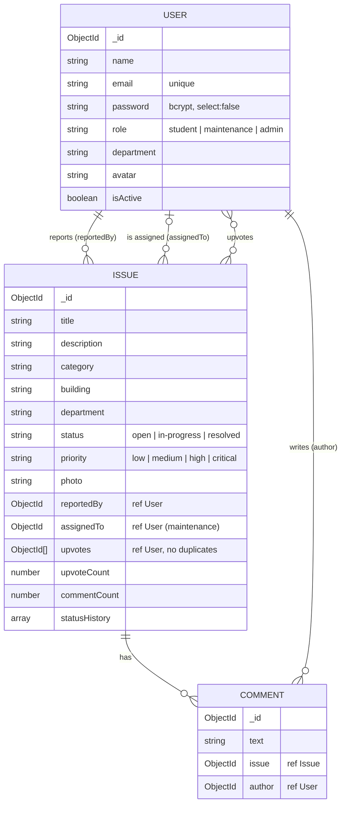

# FixItHub – Campus Issue & Maintenance Tracker

A full-stack web app where students report campus problems (Wi-Fi, broken computers, electricity, furniture, hostel issues), upvote and discuss them, and track progress, while admins assign maintenance staff, set priority and status, and see analytics.

**Live demo:** _add your Render / Netlify link here_ · **Demo video:** _add link_

## Features

**Core**
- [x] User registration (unique email, bcrypt-hashed password)
- [x] Login / logout with JWT
- [x] Protected API routes and frontend route guards
- [x] Full CRUD on issues (plus comments and users)
- [x] User-owned data (students edit/delete only their own issues and comments)
- [x] Server-side validation (express-validator) and client-side validation
- [x] Central error handling with correct HTTP status codes
- [x] Responsive UI (mobile-first CSS, Flexbox / Grid)
- [x] Secrets in `.env`, `.env.example` provided
- [x] README with setup, API list, DB diagram

**Intermediate**
- [x] Role-based access: `student`, `maintenance`, `admin`
- [x] Pagination, text search, filters (status, category, building, department, priority) and sorting
- [x] Profile page (update details, avatar upload, change password)
- [x] Photo upload with Multer (type + size validated)
- [x] Loading, empty and error states, toasts, confirm dialogs
- [x] Dashboard with Chart.js charts from a MongoDB aggregation endpoint
- [x] Rate limiting and security headers (helmet, express-rate-limit, mongo-sanitize, CORS)
- [x] Request logging (morgan)

**Extra**
- [x] Duplicate-proof upvotes (atomic toggle, one vote per user, cannot upvote own issue)
- [x] Comments with delete permissions
- [x] Status history timeline per issue
- [x] Admin assigns maintenance staff; assigned staff can update status
- [x] Automated tests (Jest + Supertest)
- [ ] Email notifications (planned)

## Tech stack

| Layer | Technology |
|---|---|
| Frontend | HTML5, CSS3, vanilla JavaScript (ES modules), Fetch API, Chart.js |
| Backend | Node.js, Express.js (REST API, MVC) |
| Database | MongoDB + Mongoose |
| Auth | JWT (`jsonwebtoken`), `bcryptjs` |
| Upload | Multer |
| Security | helmet, cors, express-rate-limit, express-mongo-sanitize, express-validator |
| Testing | Jest, Supertest |

## Folder structure

```
FixItHub/
├── README.md
├── .gitignore
├── docs/screenshots/            # put your screenshots here
├── backend/
│   ├── server.js                # entry point
│   ├── seed.js                  # demo data
│   ├── .env.example
│   ├── uploads/                 # uploaded images (git-ignored)
│   ├── src/
│   │   ├── app.js               # express app (middleware + routes)
│   │   ├── config/              # db.js, constants.js
│   │   ├── models/              # User, Issue, Comment
│   │   ├── controllers/         # auth, user, issue, comment, dashboard, meta
│   │   ├── routes/
│   │   ├── middlewares/         # auth, error, validate, upload
│   │   ├── validators/
│   │   └── utils/
│   └── tests/                   # auth.test.js, issue.test.js
└── frontend/
    ├── index.html               # landing page
    ├── pages/                   # login, register, dashboard, issues, issue, issue-form, profile, admin, 404
    ├── css/                     # variables, base, layout, components
    └── js/                      # config, api, auth, ui, utils, pages/*
```

## Getting started

**Requirements:** Node.js LTS, Git, and MongoDB (local Community Server or a free MongoDB Atlas cluster).

```bash
git clone https://github.com/<your-username>/FixItHub.git
cd FixItHub/backend
npm install
cp .env.example .env        # Windows: copy .env.example .env  -> then edit values
npm run seed                # optional: demo users and sample issues
npm run dev                 # http://localhost:5000
```

Open **http://localhost:5000**. The Express server also serves the `frontend` folder, so no extra step is needed.

_Alternative:_ open `frontend/` with VS Code **Live Server** (usually `http://127.0.0.1:5500`). The frontend then calls the API at `http://localhost:5000`; make sure `CLIENT_URL` in `.env` contains your Live Server origin.

### Environment variables (`backend/.env`)

| Variable | Description |
|---|---|
| `PORT` | Server port (default 5000) |
| `NODE_ENV` | `development` or `production` |
| `MONGO_URI` | MongoDB connection string |
| `MONGO_URI_TEST` | Separate database used only by the automated tests |
| `JWT_SECRET` | Long random string used to sign tokens |
| `JWT_EXPIRES_IN` | Token lifetime, e.g. `7d` |
| `CLIENT_URL` | Comma-separated allowed frontend origins (only for Live Server) |

Generate a strong secret: `node -e "console.log(require('crypto').randomBytes(48).toString('hex'))"`

### Demo accounts (created by `npm run seed`, demo data only)

| Role | Email | Password |
|---|---|---|
| Admin | admin@demo.com | Demo@1234 |
| Student | student@demo.com | Demo@1234 |
| Student | diya@demo.com | Demo@1234 |
| Maintenance | ramesh@demo.com | Demo@1234 |

Everyone who registers through the form becomes a **student**. Admins promote users to `maintenance` or `admin` from **Manage → Users**.

## Database relationships



## API documentation

Base URL: `/api/v1`. Responses are always JSON:
`{ "success": true, "data": ..., "message": "..." }`, lists add `"pagination": { page, limit, total, pages }`, errors return `{ "success": false, "message": "...", "errors": [{ field, msg }] }`.
Send the token as `Authorization: Bearer <token>`.

| Method | Endpoint | Access | Description |
|---|---|---|---|
| GET | `/meta` | Public | Dropdown options (categories, buildings, departments...) |
| POST | `/auth/register` | Public | Create student account |
| POST | `/auth/login` | Public | Login, returns JWT |
| GET | `/auth/me` | Private | Current user |
| PUT | `/auth/change-password` | Private | Change own password |
| PUT | `/users/profile` | Private | Update own profile (multipart, `avatar` file) |
| GET | `/users` | Admin | List users. Query: `search, role, page, limit` |
| GET | `/users/staff` | Admin | Active maintenance staff |
| PUT | `/users/:id/role` | Admin | Change a user's role |
| PUT | `/users/:id/status` | Admin | Activate / deactivate (`{ "isActive": false }`) |
| DELETE | `/users/:id` | Admin | Deactivate user (soft delete) |
| GET | `/issues` | Private | List issues. Query: `search, status, category, building, department, priority, mine, assignedToMe, assignedTo (admin; id or none), sort, page, limit` |
| POST | `/issues` | Private | Report issue (multipart, optional `photo`) |
| GET | `/issues/:id` | Private | Issue details with status history |
| PUT | `/issues/:id` | Owner (while open) / Admin / assigned staff | Update. Admin: also `status, priority, assignedTo`. Staff: `status` only |
| DELETE | `/issues/:id` | Owner / Admin | Delete issue, its photo and comments |
| POST | `/issues/:id/upvote` | Private | Toggle upvote (one per user) |
| GET | `/issues/:id/comments` | Private | List comments (paginated) |
| POST | `/issues/:id/comments` | Private | Add comment `{ "text": "..." }` |
| DELETE | `/comments/:id` | Author / Admin | Delete comment |
| GET | `/dashboard/stats` | Private | Analytics (admin: all issues, optional `building, category, department`; others: own issues) |

Sort values for `/issues`: `createdAt`, `-createdAt`, `upvoteCount`, `-upvoteCount`, `commentCount`, `-commentCount`.

| Status | Used when |
|---|---|
| 200 / 201 | Success / created |
| 400 | Validation failed, invalid ID |
| 401 | Missing/invalid token, wrong credentials |
| 403 | Not allowed (role or not owner) |
| 404 | Not found |
| 409 | Duplicate email |
| 429 | Rate limit hit |
| 500 | Unexpected error |

## Security

- Passwords hashed with bcrypt (12 rounds), never returned (`select: false`)
- Role is never accepted from the registration body
- Ownership and role checks on every update/delete; only whitelisted fields are updated
- helmet (CSP), CORS allow-list, rate limiting (stricter on login/register), 10 KB body limit, NoSQL-injection sanitising
- Upload filter: JPG/PNG/WEBP only, 3 MB max, random file names, extension from verified MIME type
- Search input is regex-escaped, sort fields are whitelisted, all rendered user text is HTML-escaped (XSS)
- Production error responses hide stack traces

## Testing

1. Make sure MongoDB is running and `MONGO_URI_TEST` points to a **throw-away** database (the tests drop it).
2. Run:

```bash
cd backend
npm test
```

Covers registration, duplicate email, weak password, role-injection attempt, login, protected routes, password change, issue CRUD, validation, ownership (403), pagination/search/filter, duplicate-upvote prevention, comments, admin assignment, staff permissions, admin-only routes, analytics and user deactivation.

### Manual test cases

| Test | Expected |
|---|---|
| Register with an existing email | 409 and an error message |
| Login with a wrong password | 401 "Invalid email or password" |
| Open a private page without logging in | Redirect to login |
| Edit or delete another student's issue | 403 |
| Student tries to change status or priority | 403 |
| Upvote the same issue twice | Second click removes the vote, never counts twice |
| Upload a 10 MB or non-image file | Rejected with a clear message |
| Submit an empty form | Inline field errors |
| Delete an issue and refresh | Issue and its photo are gone |
| Student opens `/pages/admin.html` | 404 page |

## Screenshots

Add images to `docs/screenshots/` and link them here:

| Page | Screenshot |
|---|---|
| Login / Register | `` |
| Student dashboard | `` |
| Issue list with filters | `` |
| Issue details + comments | `` |
| Admin analytics | `` |
| Admin management | `` |

## Deployment (free tier)

| Part | Service | Notes |
|---|---|---|
| Database | MongoDB Atlas (M0) | Create user, allow network access, copy URI to `MONGO_URI` |
| Backend + frontend | Render / Railway | Root directory `backend`, build `npm install`, start `npm start`. Add the env variables in the dashboard. Express serves the frontend, so one service is enough |

Uploaded images are stored on the server's disk, which is wiped on free hosts after each redeploy. For permanent storage switch Multer to Cloudinary. Free backends may sleep, so the first request can take up to a minute.

## Author

URVISH
